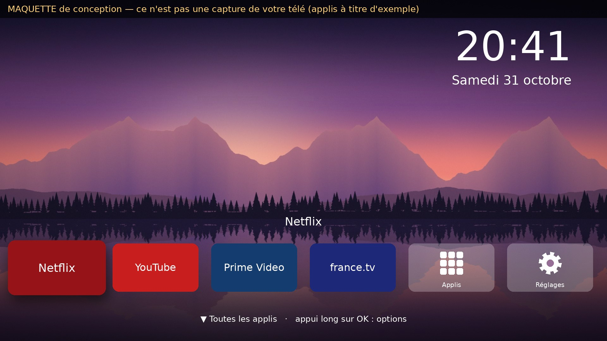

# Android TV allégée + Accueil Zen

Kit complet pour rendre une Android TV / Google TV plus rapide et sans pubs, **de façon 100 % réversible** :

1. **trouve la télé** sur votre Wi-Fi et s'y connecte en ADB ;
2. **sauvegarde tout** avant la moindre modification ;
3. **désactive** (sans jamais désinstaller) les pubs, la télémétrie et les applis inutiles, **en vous demandant** pour tout ce que vous pourriez utiliser ;
4. **installe Accueil Zen**, un écran d'accueil minimaliste façon Apple TV : dock de vos applis préférées, horloge, fonds d'écran nature qui défilent en fondu ;
5. **prend une capture de la télé à chaque étape** et les rassemble dans un rapport illustré ;
6. **restaure tout** en une commande, ou avec un script autonome.


*Maquette de conception. Ce n'est pas une capture de votre télé : les vraies captures sont prises par le script.*


*Les 8 fonds intégrés (paysages générés par programme, libres de droits). Vous pouvez ajouter vos propres photos.*

---

## Ce qu'il vous faut

| Élément | Détail |
|---|---|
| Un ordinateur | Windows, Mac ou Linux, **sur le même Wi-Fi que la télé** |
| Python 3.8 ou plus | Windows : [python.org](https://www.python.org/downloads/) (cochez « Add to PATH »). Mac : déjà présent ou `brew install python` |
| ADB | Téléchargé automatiquement depuis le site officiel de Google au premier lancement si absent |
| La télé | Android TV / Google TV **7.0 ou plus**, allumée |

## Étape 0 : autoriser l'ADB sur la télé (une seule fois, avec la télécommande)

1. **Paramètres → Système** (ou *Préférences de l'appareil*) **→ À propos**.
2. Descendez sur **Build** (ou *Version du build*) et appuyez **7 fois sur OK**, jusqu'au message « Vous êtes maintenant développeur ».
3. Revenez en arrière, puis ouvrez **Options pour les développeurs**.
4. Activez **Débogage USB** et, s'il existe, **Débogage réseau** / *ADB over network*.

Les intitulés exacts changent un peu selon la marque.

## Étape 1 : tout faire en une commande (parcours guidé)

**Le plus simple : double-cliquez sur `LANCER-Windows.bat` (Windows) ou `LANCER-Mac.command` (Mac).**

Ou bien, dans un terminal ouvert dans le dossier `android-tv` :

```bash
python3 outils/tv_allegement.py tout        # Windows : py outils\tv_allegement.py tout
```

Le parcours, dans l'ordre :

| Étape | Ce qui se passe | Capture prise |
|---|---|---|
| Recherche | Analyse du Wi-Fi (ports 5555 ADB, 8009 Cast, 6466/6467 télécommande Android TV) | — |
| Connexion | `adb connect`. **Sur la télé, acceptez « Autoriser le débogage ? »** en cochant « Toujours autoriser » | `connexion` |
| Sauvegarde | Liste complète des paquets, paquets déjà désactivés, réglages (global/secure/system), écran d'accueil actuel, propriétés, puis génération des scripts de restauration | `avant_modifications` |
| Audit | Liste ce qui peut être allégé **sans rien modifier** | — |
| Pubs + télémétrie | Liste affichée, puis « Tout désactiver ? » (ou un par un) | `apres_pubs_telemetrie` |
| Applis que vous pourriez utiliser | **Une question par appli** (Assistant vocal, Chromecast intégré, YouTube, Netflix, Mode Ambiant…). Réponse par défaut : **garder** | `apres_applis` |
| Fabricant (TCL, Sony, Philips…) | Paquets repérés par leur nom (« promo », « analytics »…). **Une question pour chacun**, réponse par défaut : garder | `apres_fabricant` |
| Fluidité | Animations 2× plus rapides (valeurs d'origine sauvegardées) | `accueil_apres_allegement` |
| Accueil Zen | Installation, choix des favoris du dock, photos perso (facultatif), définition comme écran d'accueil, puis vérification que le bouton Accueil l'ouvre bien | `accueil_zen_premier_lancement`, `bouton_accueil`, `toutes_les_applis` |

À la fin, le **rapport illustré** `ma-tele/rapport.html` s'ouvre : toutes les captures, dans l'ordre, avec le journal de chaque modification.

> Pour voir ce qui serait fait sans rien toucher : ajoutez `--essai`, par exemple `python3 outils/tv_allegement.py --essai alleger`.

## Ce qui est protégé

* **Jamais désinstallé** : uniquement `pm disable-user` (désactivation réversible).
* **Jamais proposé** : Réglages, interface système, services Google Play, Play Store, clavier, service de télécommande, Bluetooth, HDMI/CEC, entrées TV, mises à jour, installation initiale, WebView, etc. (liste complète dans [`outils/catalogue.py`](outils/catalogue.py)).
* **L'accueil d'origine** n'est jamais désactivé pendant l'allègement. Il n'est proposé qu'à la fin, **et seulement si** la télé refuse de laisser Accueil Zen répondre au bouton Accueil (fréquent sur Google TV), avec les conséquences expliquées.
* **Sauvegarde obligatoire** : `alleger` et `installer` refusent de démarrer s'il n'y a pas de sauvegarde.
* **Garde-fou** : après chaque désactivation d'un paquet fabricant, le script vérifie que la télé répond encore. Sinon, il réactive le paquet immédiatement.

## Restaurer

Trois façons, au choix :

```bash
python3 outils/tv_allegement.py restaurer
```
Annule chaque modification dans l'ordre inverse, **vérifie** que la liste des paquets désactivés est identique à la sauvegarde, puis prend une capture.

Sans Python, avec les scripts autonomes générés dans `ma-tele/sauvegardes/<date>/` et mis à jour après chaque modification :
* Mac/Linux : `sh restaurer.sh`
* Windows : double-clic sur `restaurer.bat`

Ces scripts réactivent les paquets, remettent les réglages d'origine, rendent l'accueil d'origine et désinstallent Accueil Zen (la seule appli que nous avons ajoutée).

## Accueil Zen : utilisation

| Touche | Action |
|---|---|
| ◀ ▶ | Parcourir le dock (le nom de l'appli s'affiche au-dessus) |
| OK | Ouvrir |
| **Appui long sur OK** (ou touche Menu) dans le dock | Déplacer à gauche/droite, retirer, infos de l'appli |
| ▼ | Toutes les applis |
| Appui long sur OK dans « Toutes les applis » | Ajouter au dock / retirer du dock |
| Retour | Fermer « Toutes les applis » |
| Tuile **Réglages** | Paramètres de la télé |

* **Fonds** : changent toutes les 90 s, avec un fondu enchaîné et un zoom lent. Pour modifier l'intervalle : `python3 outils/tv_allegement.py installer --intervalle 300`.
* **Vos photos** : `python3 outils/tv_allegement.py fonds "C:\Users\moi\Images\Nature"`. Elles sont ajoutées aux 8 fonds intégrés.
* **Léger** : aucune connexion Internet, aucune pub, aucun suivi, environ 1,1 Mo.

## Commandes disponibles

```
trouver | connecter IP | sauvegarder | audit | alleger | installer | fonds DOSSIER | capture NOM | restaurer | rapport | tout
```

## Recompiler l'appli (facultatif)

`dist/AccueilZen.apk` est déjà compilé et signé. Pour le reconstruire (Linux/Mac, JDK 17+, Python 3 avec Pillow et NumPy) :

```bash
cd launcher && ./construire.sh
```
Le script télécharge depuis Maven Central : apktool (pour aapt2 et les ressources du framework Android), dx, apksig et android-all. Il génère les fonds, compile, assemble, puis signe l'APK (signature v2). La clé de signature `launcher/cle/accueilzen.p12` est versionnée exprès : sans elle, une mise à jour ne pourrait pas s'installer par-dessus. C'est une clé personnelle, sans valeur hors de ce projet.

## Limites (honnêtement)

* La liste des applis fabricant est **détectée d'après leur nom**, pas d'après une base vérifiée par modèle : c'est pour ça que chaque paquet vous est demandé.
* La télémétrie intégrée aux services Google Play ne peut pas être coupée sans casser la télé. Le script désactive ce qui peut l'être proprement, puis vous indique les interrupteurs à basculer vous-même (*Confidentialité → Annonces* et *Utilisation et diagnostics*).
* Les captures peuvent être noires pendant la lecture d'une vidéo protégée (Netflix…). C'est une protection d'Android, pas une panne.
* Une mise à jour du système de la télé peut réactiver certaines applis. Il suffit alors de relancer `alleger`.
